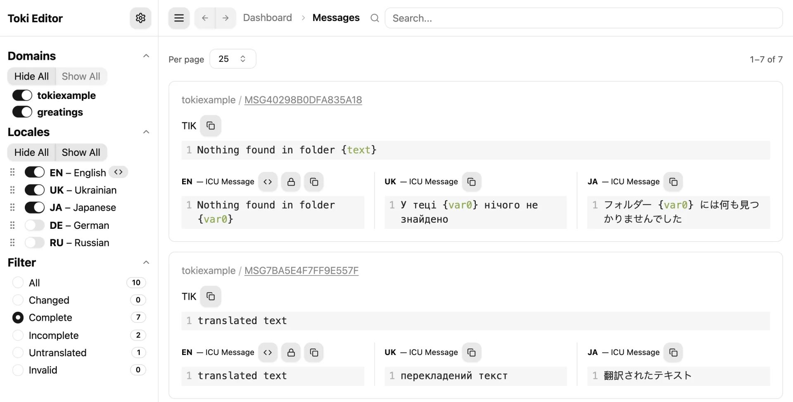

# Introduction

Toki is an i18n framework for Go and a Textual Internationalization Key ([TIK](https://github.com/romshark/tik)) processor implementation.

`toki generate` parses the source code, lints it reporting any misuse or errors, extracts localized texts and generates a localization bundle.

[app-resource-bundle (.arb)](https://github.com/google/app-resource-bundle) files are used as intermediate translation storage for [ICU messages](https://unicode-org.github.io/icu/userguide/format_parse/messages/) generated from TIKs extracted from the source code.

`toki edit` opens a desktop editor app for comfortable manual translation editing.

<picture>
  <source media="(prefers-color-scheme: dark)" srcset="img/editor-dark.webp">
  
</picture>

## A new, better way to internationalize

Traditional key-based i18n refers to each text by an abstract key, and keeps the text in a file away from the code:

```go
i18n.ByKey("dashboard.report.summary", numberOfMessages, dateTime)
```

With TIK and Toki, the text in the code ***is*** the key:

```go
reader.String(`You had {# messages} at {time-short}.`, numberOfMessages, dateTime)
```

- **Readable code**: anyone reading the code, AI agents included, sees exactly what users will read, with no keys to look up or name.
- **More context for translators**: the comment above a call goes into the catalog as the description of its message. A [context](https://github.com/romshark/tik/blob/main/SPECIFICATION.md#context), as in `[verb] Book`, tells apart texts that read the same but translate differently.

  ```go
  // Status of a meeting room that nobody booked for the selected time.
  reader.String(`Free`)
  ```

  Without the comment, a translator might read `Free` as "at no cost" and write German "Kostenlos" instead of "Frei".
- **Generated messages**: Toki writes the ICU message of the default language from the TIK, with its plurals, dates and times. You add only the plural forms that a TIK can't express, as English `one`.
- **Mistakes caught before production**: `toki generate` and `toki lint` check every call, locally and in CI/CD. They report a missing or extra argument, an argument of the wrong type, and a plural or select option that a language doesn't have. With `-require-complete`, CI fails on messages that aren't fully translated.
- **Compiled catalogs**: Toki compiles every message into a Go function that writes its text and arguments straight to the output. Rendering a message takes a map lookup and a function call, with no translation files to read at startup and no ICU messages to parse or interpret on each call. `Write` streams into any `io.Writer`, and `String` renders into a pooled buffer. The translations ship inside your binary, with no files to deploy or keep in sync.

## Next steps

[Install toki](1-get-started/1-installation.md), follow the [quick start](1-get-started/2-quick-start.md) to internationalize a Go program, then [add languages](1-get-started/3-add-languages.md) to it.
